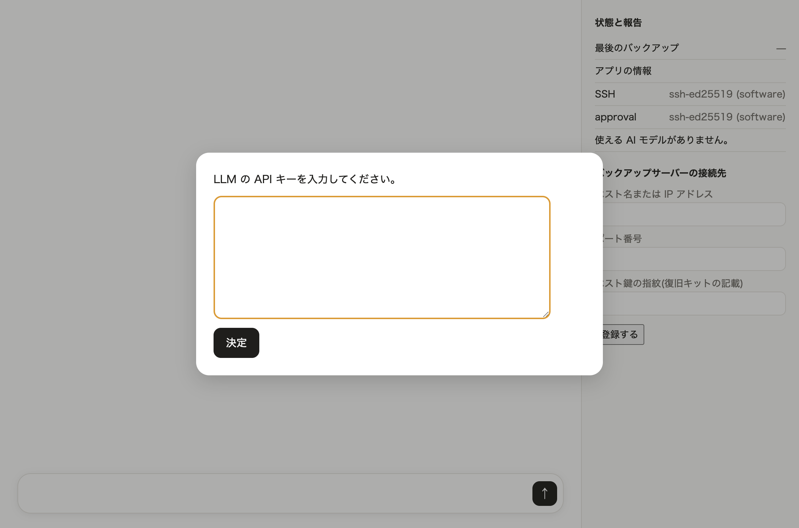
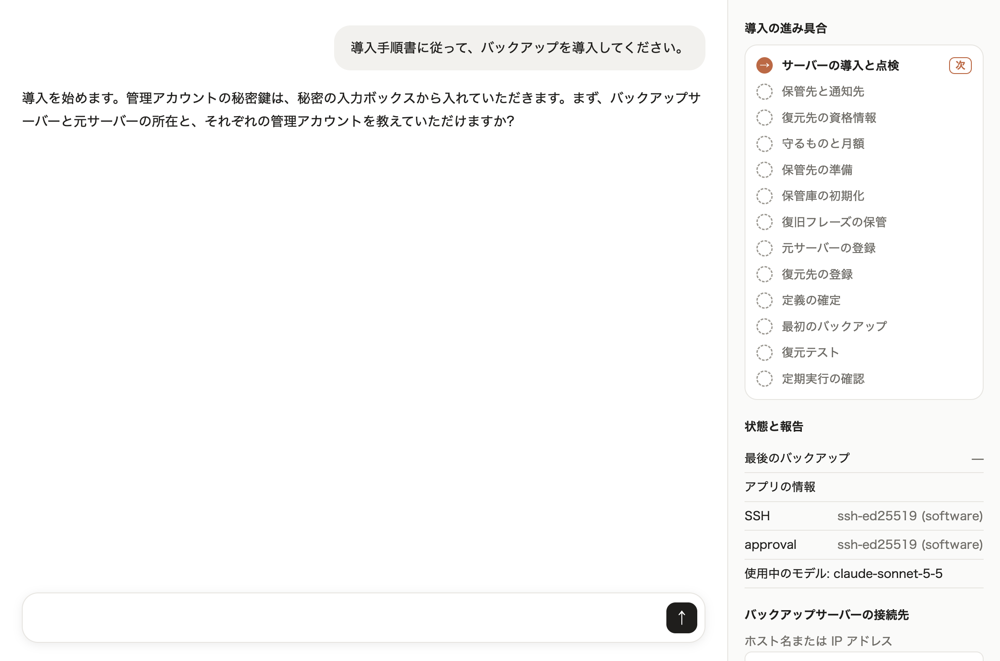
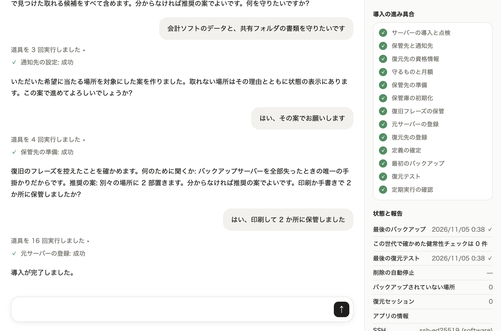

# Sitate-backup ユーザーガイド

## 0. このガイドについて

- 誰向けか: Sitate-backup を導入して使う事業所の方です。IT の担当でなくても読めるように書いています。サーバーの管理用のログインの用意など、一部の作業は、サーバーの事業者や詳しい人の手を借りる前提です。
- 何が書いてあるか: 始める前に用意するもの、導入の流れ、承認カードの読み方、導入の後に起きること、困ったときにすること、秘密の扱い、まだできないことです。
- どの版についてか: 製品の commit `f9fa3d8` の版(提出するビルド)でできることだけを書いています。
- 導入の手順そのものは、導入手順書 [`docs/install.md`](/docs/install.md) にあります。手順書は、人と Claude が同じ文面で使います。このガイドは、そのうち人の側を説明します。
- この版はアプリを配っていません。リポジトリから誰でも組めるのは、受入試験の環境のための試験ビルドで、実際のサーバーには使えません。実際のサーバーに使う製品ビルドは、配布用の鍵で署名して組みます([README](/README.md) の「製品ビルド」。開発者の作業です)。製品ビルドで実際のサーバーへ導入する通しは、まだ確かめていません(8 章)。
- このガイドの流れと画面は、試験ビルドと合成データの受入試験の環境で確かめたものです。画面の写しの値はすべて合成で、会話の文は試験用の代わりの応答です。

## 1. Sitate-backup がすること・しないこと

Sitate-backup は、IT 担当者のいない小さな事業所のためのバックアップの製品です。管理者の端末のアプリで Claude と会話しながら導入し、その後はタイマーで、バックアップと復元テスト(別のサーバーへ実際に戻して確かめること)を続けます。

Claude(製品の中の AI。アプリが API で呼びます)にさせることと、させないことは次のとおりです。

| させること | させないこと |
|---|---|
| 聞く(何を守りたいかなど) | 鍵を見る |
| 調べる(元サーバーを読み取りだけで調べる) | 人の承認なしに危険な操作をする |
| 提案する(バックアップの対象の案、変更の案) | |
| 説明する(結果や通知の意味) | |

させないことは、頼み方の約束ではなく、仕組みとしてさせません。Claude が出せるのは操作の案だけです。案を実行するのはアプリです。危険な変更は、人が承認カードで承認しなければ実行されません(4 章)。このため、AI だけではバックアップを消せません。

次は人が行います。

- 危険な変更の承認(承認カード)。
- 試験通知で受け取った確認語の入力。
- 秘密の入力(保管先の管理用の鍵、サーバーの管理用の鍵、通知先の URL など)。
- 復旧フレーズの保管と、復旧キットの保管の確認。

登場するものは次のとおりです。

| 名前 | 意味 |
|---|---|
| 元サーバー | 守りたいデータがあるサーバー |
| バックアップサーバー | 元サーバーからデータを取りに行き、保管先へ送るサーバー。毎日のバックアップと復元テストはここで動きます |
| 保管先 | バックアップを置く場所(事業者のデータの置き場のサービス)。管理者が自分で契約します |
| 復元先 | 復元テストで、試しに戻すためのサーバー |
| 管理者端末 | アプリを動かす、管理者の手元のパソコン |

## 2. 始める前に用意するもの

| 用意するもの | 説明 |
|---|---|
| 管理者端末とアプリ | 管理者端末は macOS が要ります(秘密を macOS のキーチェーンに置く作りのため)。アプリの用意は 0 章のとおりです |
| バックアップサーバー | Debian か Ubuntu(またはそれを元にした OS)の、何も入っていないサーバー(OS だけ入れたもの)。x86_64 か arm64。管理者端末からの管理用のログイン(SSH)は、root か、パスワードを聞かれずに sudo できるアカウントで |
| 元サーバーの所在 | ホスト名か IP アドレス。SSH を 22 番で受けていること |
| 元サーバーの管理用のアカウント | root か、パスワードを聞かれずに sudo できるアカウントの名前と、その SSH の秘密鍵(パスフレーズの無いもの) |
| 通知の受け口 | 通知を受け取る Webhook の URL。JSON(機械向けの文字の形式)を受けて、人が読める形で表示できるものを事前に作っておきます。製品は出来事の JSON をそのまま送ります。実物のチャットやメールの受け口で受けられるかは、この版では確かめていません |
| LLM API キー | Anthropic Console で発行する API キー。Claude を動かすのに使います。サブスクリプションの転用は使いません |
| バックアップサーバーの事業者とプラン名 | 分かれば。月額の目安を出すのに使います |

導入の途中で、次も必要になります(3 章の H1〜H3)。

- 保管先の契約(この版の保管先は Backblaze B2 です)。
- 復元先にするサーバー。Linux で、元サーバーのある業務のネットワークにつながないもの。条件は手順書の付録「`ssh-host` の復元先」にあります。
- 復旧フレーズを写すための、プリンターか紙とペン。

費用は次で発生します。金額はここには書きません。

- バックアップサーバーと復元先のサーバー。
- 保管先。
- LLM API の利用(キーの持ち主に請求されます)。

保管先の月額の目安は、導入の手順 4 で Claude が示します。この目安には、バックアップサーバー・復元先・LLM API の費用は含まれません。事業者の側で、請求額の知らせや上限を設定しておいてください。

LLM API は、契約の条件(入力の扱い、保持、処理の地域)を読んでから契約してください。処理の地域を日本に固定することはできません。

導入の前か途中に人が確かめることの一覧は、手順書の「確認項目」にあります(保管先のアカウントの多要素認証、保管先を元サーバーと別の事業者・アカウントにすることなど)。

## 3. 導入の流れ

導入の手順そのものは、導入手順書 [`docs/install.md`](/docs/install.md) にあります。手順書には、手順 1〜13、人への問い Q1〜Q4 と人の作業 H1〜H5、手順のやり直しが書いてあります。Claude はこの手順書に沿って導入を進めます。この章は、そのうち人がすること(答える、鍵を入れる、承認する)を順に説明します。

### 3.1 アプリを開く

1. アプリを起動すると、最初に LLM API キーの入力ボックスが開きます。キーを入れて「決定」を押します。

   

2. チャット欄に「始める」のボタンが出ます。押すと、導入が始まります。
   - 右側の「バックアップサーバーの接続先」の欄には、導入の前は何も入れません。ここに登録すると「始める」が出なくなります。導入は会話で進めます。手順 1 が済むと、アプリがこの欄にバックアップサーバーを記録します。
3. Claude が、バックアップサーバーと元サーバーの所在と、それぞれの管理用のアカウントを聞きます。答えはチャットに書きます。
4. 管理用の鍵は、チャットではなく、アプリが開く秘密の入力ボックスに入れます。

画面の右側の「導入の進み具合」に、手順 1〜13 が並びます。済んだ手順に印が付き、次の手順に「次」の札が付きます。チャット欄の「道具を N 回実行しました」の行は、アプリが Claude の案を実行した記録です。

### 3.2 手順 1〜13

各手順の詳しい中身は、手順書の「手順 1〜13」の節にあります。

| 手順 | 画面の項目名 | 何をするか | 人がすること |
|---|---|---|---|
| 1 | サーバーの導入と点検 | バックアップサーバーに製品を置き、配布物の署名を確かめます。最後に、バックアップサーバーへの管理用のログインを閉じます | 所在と管理用のアカウントを伝え、鍵を入れる |
| 2 | 保管先と通知先 | 保管先の設定を、実行の前に確かめます | H1、Q1 |
| 3 | 復元先の資格情報 | 復元先の登録を、実行の前に確かめます | H3、Q3 |
| 4 | 守るものと月額 | 元サーバーを読み取りだけで調べ、対象の案と月額の目安を出します。通知先を登録し、試験通知を送ります | Q4。試験通知の確認語を控える |
| 5 | 保管先の準備 | 保管先を作り、設定と鍵の権限を確かめます | 保管先の管理用の鍵をもう一度入れる |
| 6 | 保管庫の初期化 | バックアップを暗号化する鍵を作ります | なし |
| 7 | 復旧フレーズの保管 | 復旧フレーズを画面に出し、保管を確かめます | H2、Q2 |
| 8 | 元サーバーの登録 | 元サーバーに、読み取り専用の受け口を置き、取れるかを自分で検査します | まれに H5 |
| 9 | 復元先の登録 | 復元先を登録し、ほかから切り離す設定を確かめます | なし |
| 10 | 定義の確定 | 対象・保管先・復元先・通知先の組(定義)を確定します | H4(承認カード) |
| 11 | 最初のバックアップ | 最初のバックアップを取ります | なし |
| 12 | 復元テスト | 別のサーバー(復元先)へ戻して、元と照合します | なし |
| 13 | 定期実行の確認 | 毎日の実行がバックアップサーバーに登録されたことを確かめます | なし |

手順 1 の後は、バックアップサーバーへの管理用のログインが閉じています。それ以後にサーバーの管理の作業が要るときは、事業者の管理画面(コンソール)から行います。閉じられなかったときは、Claude がそう伝えます。そのときは事業者の管理画面で閉じてください。

### 3.3 会話で聞かれること(Q1〜Q4)

Claude は、問いごとに「何のために聞くか」と推奨の案を添えます。分からなければ「推奨の案で」と答えて構いません。問いは目安で 4 回です。

| 問い | 手順 | 聞かれること | 何のために |
|---|---|---|---|
| Q1 | 2 | 保管先の接続先(エンドポイント)とバケット名(保管先の中の入れ物の名前)、保管先の管理用の鍵、通知先の URL | バックアップの送り先と、失敗したときの知らせ先を決めるため |
| Q3 | 3 | 復元先の所在と、管理用のアカウントの鍵 | 復元テストを、別のサーバーで本当に試すため |
| Q4 | 4 | 何を守りたいか | 取れていない場所は、被災のときに戻せないため |
| Q2 | 7 | 復旧フレーズを 2 か所に保管したか | バックアップサーバーを全部失ったときの、唯一の手掛かりだから |

Q4 では、Claude が先に元サーバーを調べ、見つけた場所を種類と大きさで示してから聞きます。

- 「会計ソフトのデータと、共有フォルダの書類」のように、自分の言葉で答えて構いません。
- 分からなければ、取れる候補をすべて含む案になります。
- 見つけた場所の実名(パスやデータベースの名前)は、Claude には送られません。実名は画面の右側の「元サーバーの調査の結果」で見られます。
- 対象にしない場所は、人の判断として記録に残り、週次の報告に毎回出ます。
- 調べていない置き場は、チャットで伝えれば対象にできます。
- 案と月額の目安を見て、違えば直すよう伝えます。

### 3.4 自分でする作業(H1〜H4)

| 作業 | いつ | すること |
|---|---|---|
| H1 | 手順 2 の前 | 保管先の事業者と契約し、支払いを設定し、管理用の鍵を発行する |
| H3 | 手順 3 の前 | 復元先にするサーバーを借りる |
| H2 | 手順 7 | 復旧フレーズを印刷か手書きで 2 部作り、別々の場所に置く |
| H4 | 手順 10 | 承認カードで、試験通知で受け取った確認語を入れて承認する |

H5 は、元サーバーに必要な道具が無いときだけの作業です。Claude が入れ方を示し、人(または頼んだ人)が元サーバーで入れます。起きたときは、人の作業が 5 つになります。

保管先と復元先の事業者ごとの準備は、手順書の付録「事業者別(組 A)」にあります。手を借りる人に見せてください。

### 3.5 承認カードで確かめる(手順 10)

手順 10 で、「定義の確定」の承認カードが開きます。カードには、バックアップの対象の一覧(実名)、対象にしないもの、保管先、復元先、通知先が並びます。

- 対象に漏れが無いかを見ます。
- 通知先ごとの確認語の欄に、手順 4 の試験通知で受け取った語を入れます。Claude やチャットから伝えられた語ではなく、通知で直接受け取った語を入れてください。語が合わなければ、承認は受け付けられません。
- 「承認する」を押します。

カードの読み方は 4 章にあります。

### 3.6 初回のバックアップと復元テスト

確定の後、Claude が最初のバックアップを取り(手順 11)、続けて復元テストを行います(手順 12)。

復元テストでは、バックアップを復元先へ実際に戻し、元と照合し、その後に破棄します。データベースは、書き出したファイル(ダンプ)として取って戻します。

### 3.7 完了の報告

手順 13 まで済むと、Claude が導入の完了を報告します。取れていない場所があれば、報告に含まれます。右側の「状態と報告」に、最後のバックアップと最後の復元テストの日時と印が出ます。

## 4. 承認カードの読み方

### 4.1 何を承認するのか

承認カードは、危険な変更を実行してよいかを人が決めるための画面です。

- 危険な変更には、すべて人の承認が要ります。例: 定義の確定、通知先の追加・変更、元サーバーや復元先の変更、待ち時間の変更、復元テストを減らすこと。
- カードの本文は、バックアップサーバーが記録した変更の案から、アプリが決まった書式で描きます。Claude はカードを作れません。
- Claude の説明は、別枠の「AI の説明(参考)」に出ます。本文と食い違うときは、本文を正としてください。
- 承認は、アプリが管理者端末の中の鍵(承認鍵)で署名して伝えます。署名の無い変更は実行されません。

### 4.2 カードの区画

| 区画 | 見ること |
|---|---|
| 見出し | 何の変更か。「戻せない変更」の印が付くことがあります |
| 対象 | 変更する範囲 |
| 変更前後の値 | 何がどう変わるか |
| 取り消しの可否 | 後から戻せるか |
| 費用の増減 | 月額が変わる変更では、その増減 |
| 適用の時期 | すぐ適用されるか、時間をおいて適用されるか。承認の期限 |
| この操作に固有の項目 | 確認語の欄、ホスト鍵の指紋(サーバーの身元を示す文字列)など |
| AI の説明(参考) | Claude の説明 |

ホスト鍵の指紋が出たときは、事業者の画面などで確かめた指紋と照らしてください。

### 4.3 すぐ適用される操作と、時間をおいて適用される操作

「適用の時期」には、次のどちらかが出ます。

- 「今承認すると、すぐに適用できます。」
- 「今承認すると、24 時間後に適用されます。」(待ち時間の既定は 24 時間です)

すぐ適用される操作の例: 導入の最後の定義の確定、通知先の追加、実行時刻などの設定の変更。

時間をおいて適用される操作の例: 通知先の変更・削除、元サーバーや復元先の変更、待ち時間の変更、復元テストを減らす・止めること。

時間をおいて適用される操作では、待ち時間の間に通知先へ知らせが送られます。

- 承認したとき。
- 適用のおよそ 6 時間前。
- 適用したとき。

待ち時間の間に、どの通知先にも知らせが受け取られなければ、その変更は適用されません。適用が延び、やがて失効します。

### 4.4 取り消し

- カードの「取り消す」を押すと、その変更の案を取り消します。
- 「閉じる」を押すと、何もせずにカードを閉じます。変更の案は残り、承認されないまま 7 日で失効します(期限はカードに出ます)。
- 承認した後でも、適用が始まる前なら取り消せます。この版では、アプリで Claude に「保留中の変更を取り消して」と頼みます。
- 適用が始まった後は、取り消せません。

心当たりの無い変更の知らせが来たときは、適用の前に取り消してください(6 章)。

## 5. 導入の後

### 5.1 毎日のバックアップと復元テスト

- バックアップは、既定では毎日 2 時 30 分(日本時間)に取ります。
- 復元テストは、この版では毎日、バックアップの後に行います。仕様では月 1 回ですが、同じ月に合格済みなら行わない判定がまだ入っていません(8 章)。
- 復元テストは毎回、保管先からバックアップの全量を読み出します。保管先の料金の決め方によっては、読み出しの費用が出ます。
- どちらもバックアップサーバーが自分で動かす作りで、アプリを開いておく必要はありません。
- 戻せるのは、90 日前まで毎日、1 年前まで月ごとのバックアップです。この期間は固定です。それより古いバックアップは、製品が承認なしで片付けます。
- 保管先(Backblaze B2)に置くのは、バックアップサーバーで暗号化したデータだけです。データを読む鍵は、暗号化した形でしか保管先に置かないので、保管先の事業者もデータの中身は読めません。データの量や書き込んだ時刻は、保管先から見えます。暗号の形式は自作で、第三者の確認はまだ受けていません(8 章)。
- 保管先のバックアップは、保持期限が来るまで誰も消せない設定で書き込みます(保管先の「Compliance」モードのロック)。管理者本人も消せず、製品を止めても残り、その間の保存の料金がかかります。データは書き込みから少なくとも 90 日残ります。各月の最初のバックアップは約 12 か月残す作りで、その目録は書き込みのときから約 12 か月、中身のデータは週 1 回(日曜)の延長が動いたときに約 12 か月へ延びます。1 回だけ試して止めた場合も、データは少なくとも 90 日残ります。消せないことは保管先の設定によるもので、製品の受入試験ではまだ確かめていません(8 章)。
- 復元テストで確かめるのは、戻したデータが記録と一致するかまでです。データベースへ読み込めるかを確かめる検査は、この版にはありません(8 章)。

導入の手順 13 で確かめたのは、毎日の実行がバックアップサーバーに登録されたことまでです。この版を長く動かした実績は、まだありません。

### 5.2 通知と週次の報告

- 通知は、バックアップサーバーから通知先の Webhook へ送られます。
- 通知の中身は、出来事の種類(`type`)と値を書いた JSON です。文章の説明は付きません。意味はアプリで Claude に聞けます(6 章)。
- 実物のチャットやメールの受け口で受けられるかは、この版では確かめていません。受入試験の受け手は、試験用のものだけです。
- 毎日の成功は通知しません。
- 週に 1 回、その週に取れたバックアップの一覧と、最後に復元できた日を報告として送ります。対象にしないと決めた場所も、実名ではなく番号で、毎回この報告に載ります。

### 5.3 「状態と報告」の読み方

アプリの右側の「状態と報告」は、バックアップサーバーの状態をアプリが直接描いたものです。Claude を通さないので、Claude が止まっていても見られます。アプリを起動したときと、操作の後に読み直します。

| 行 | 意味 |
|---|---|
| 最後のバックアップ | 最後に取った日時。✓ は成功、✗ は失敗 |
| この世代で確かめた健常性チェックは 0 件 | この版には、ランサムウェアの兆候などの検査がまだありません。その事実を示す行です |
| 最後の復元テスト | 最後に行った日時。✓ は合格、✗ は不合格 |
| 削除の自動停止 | ● なら、古いバックアップの片付けを製品が止めています。失敗が続いたときなどに止まります |
| バックアップされていない場所 | この版では常に 0 です。導入の後に元サーバーに増えた場所を数える仕組みは、まだありません。導入のときに取れなかった場所は、導入の完了の報告(3.7)に載ります |
| 復元セッション | この版では使いません(常に 0) |

保留中の変更(承認待ち、または適用待ちの変更)があるかは、この版の画面には出ません。Claude に「保留中の変更はある?」と聞いてください。

- 値が変わった行(新しい警告、失敗、削除の自動停止など)には、「AI に見立てを聞く」のボタンが出ます。押すと、Claude が状況と次にすることを説明します。ボタンが出るのは、アプリを起動したままで値が変わったときです。アプリを閉じている間に起きた失敗には、起動の直後は出ません。
- バックアップサーバーに接続できないときは、最後に確認した情報に「(古い情報)」の印を付けて出します。
- アプリが状態を読み直したとき、バックアップが 2 日より前から無いことなどに気づくと、OS の通知でも知らせます。
- 「アプリの情報」には、使っている AI のモデルの名前が出ます。

## 6. 通知が来たとき・困ったとき

分からないときは、アプリで Claude に聞いてください。通知の JSON をそのまま貼るのではなく、「バックアップの失敗の通知が来た」のように伝えれば、Claude が状態を調べて説明します。

通知の `type` に出る語の例と、人がすることは次のとおりです。

| `type` の例 | 何が起きたか | 人がすること |
|---|---|---|
| `notify.test` | 試験通知 | `confirmation_word` の値(確認語)を控え、承認カードの欄に入れる |
| `backup.failed`・`backup.partial` | バックアップの失敗、または一部の失敗 | アプリを開き、「状態と報告」を見て Claude に聞く。元サーバーが止まっていないか確かめる |
| `restore_test.failed` | 復元テストの不合格 | 同じく Claude に聞く。戻せない状態の可能性があるので、後回しにしない |
| `hold.set` | 古いバックアップの片付けを止めた | Claude に原因を聞く。解除には承認が要る |
| `change.proposed`・`change.approved`・`change.applying_soon` | 危険な変更の提案・承認・適用の前 | 自分が承認した変更か確かめる。心当たりが無ければ、適用の前に取り消す |
| `digest.weekly` | 週次の報告 | 最後に復元できた日が古くなっていないか見る |

よくある場面と、人がすること:

| 場面 | 人がすること |
|---|---|
| 「サーバーに接続できないため、最後に確認した情報を表示しています。」と出る | バックアップサーバーが動いているか、事業者の画面で確かめる |
| 「AI のキーが無効です。新しいキーを入れてください。」と出る | Anthropic Console で新しいキーを発行し、アプリの入力ボックスに入れる |
| 「AI の利用料の設定を確かめてください。」と出る | Anthropic Console で支払いの設定を確かめる |
| 「AI の利用が混み合っています。」「AI の提供元で障害が起きています。」と出る | 少し待ってからやり直す |
| 「エージェントが停止しました。」と出る | 「状態と報告」と承認カードは、そのまま使えます。毎日のバックアップも止まりません |
| Claude が途中で止まったように見える | 「続けてください」と送る |
| 承認カードで確認語が合わない | 試験通知を見直して入れ直す。分からなければ、試験通知をやり直すよう Claude に頼む |
| チャットに秘密を書いて送ろうとした | アプリが送信を止めます。表示される案内に従って、その秘密を差し替えてください(7 章)。復旧フレーズのときは、案内は鍵の更新を勧めますが、この版には新しいフレーズに替える方法がまだありません(8 章) |

## 7. 秘密の扱い

守ることは 3 つです。

1. 秘密をチャットに書かない。アプリが開く秘密の入力ボックスに入れます。
2. 復旧フレーズを写真やスクリーンショットで残さない。紙に残します。
3. 秘密を Claude に教えない。Claude には、秘密の値ではなく参照名(秘密に付けた呼び名)だけが渡ります。

| 秘密 | どこに入れるか | どこに置かれるか |
|---|---|---|
| LLM API キー | アプリの起動時に開く入力ボックス | 管理者端末の macOS のキーチェーン |
| バックアップサーバーの管理用の資格情報 | 導入の始めに開く入力ボックス | 管理者端末のキーチェーン。手順 1 で管理用のログインを閉じた後に消します |
| アプリの管理用の SSH 鍵(バックアップサーバーにつなぐ鍵) | アプリが作ります | 管理者端末のキーチェーン |
| 保管先の管理用の鍵 | 使うたびに開く入力ボックス(1 行目にキー ID、2 行目に鍵) | どこにも保存しません。その操作の間だけ使います |
| 元サーバー・復元先の管理用の鍵 | 導入中に開く入力ボックス | 管理者端末のキーチェーン |
| 通知先の URL | 導入中に開く入力ボックス | 管理者端末のキーチェーン |
| 承認鍵(承認の署名に使う鍵) | アプリが作ります | 管理者端末のキーチェーン |
| 保管先の読み書きの鍵 | 製品が作ります | バックアップサーバーの中。復元テストの間だけ、読み取りの鍵が復元先のメモリに渡ります。管理者端末にも Claude にも渡りません |
| 復旧フレーズ | 画面に出るのは手順 7 の間だけ | 紙だけ。管理者端末にも保存しません |

- Claude(LLM API)へ送るのは、アプリが決めた欄だけです。秘密の値は送りません。元サーバーのファイルやデータベースの実名も、参照名に置き換えて送ります。
- チャットの入力が鍵やフレーズの形をしていると、アプリは送信を止め、入力を消します。続けて、その秘密を差し替える案内を出します。一度画面に打った秘密は、漏れたものとして差し替えてください。例: LLM API キーなら、Anthropic Console で新しいキーを発行し、古いキーを無効にします。
- 復旧フレーズを打ったときは、この版には新しいフレーズに替える方法がありません(8 章)。

### 7.1 復旧フレーズと復旧キット

- 復旧フレーズは、英単語 24 語です。バックアップサーバーを全部失ったときに、保管先のデータを読むための唯一の手掛かりです。手順書では「リカバリーフレーズ」と呼んでいます。
- 復旧キットは、全部失ったときに復元するための紙 1 枚(表と裏)です。製品と保管先の情報と、復元の手順が載ります。
- 手順 7 では、フレーズの画面で次の順に進みます。
  1. 「復旧キットを印刷する」(24 語の入ったキットが印刷されます)か、「手書きで写した」を押す。
  2. 「写した語を入力して確かめる」を押し、紙に写した 24 語を入れる。入力を始めると、画面の語は消え、二度と表示されません。
  3. 2 か所に保管したら、「2 か所に保管した」を押す。
- 確かめる前に画面を閉じたときや、写し間違いで合わないときは、フレーズを作り直します。Claude が案内します。
- 2 部を別々の場所(例: 金庫と自宅)に置きます。
- Claude はフレーズの画面の中身を読めません。
- フレーズや復旧キットが漏れたとき(盗まれた・撮られたなど)に、新しいフレーズに替える方法は、この版にはまだありません(8 章)。アプリの案内は鍵の更新を勧めますが、案内のとおりに Claude に頼んでも、この版では適用できません。

## 8. まだできないこと

前半の表は [README](/README.md) の「できないことと、これから」と同じ項目です。後半は、このガイドに関わるこの版の制約です。日付は約束しません。

| いまできないこと | 何で埋めるか |
|---|---|
| 健常性チェック(ランサムウェアの兆候の検査など)はまだありません | 次のイテレーション(開発の区切り)で作り、受入試験で確かめます |
| 元サーバーを失ったときに、データを別のホストへ戻して使えるようにする復元は、まだできません。今あるのは、隔離した復元先へ戻して元と照合し、その後に破棄する復元テストまでです | 次のイテレーションで作り、受入試験で確かめます |
| 全損(バックアップサーバーも失った状態)からの復元も、まだできません | 次のイテレーションで作り、受入試験で確かめます |
| 保持期限の間に、保管先のデータの削除が保管先に拒まれることを、まだ試験で確かめていません。保持の切れたデータを片付けるための削除の権限は、バックアップサーバーの書き込み鍵が持ちます(Claude は鍵を持ちません) | その次のイテレーションで、保管先が削除を拒むことを受入試験で確かめます |
| 元サーバーのファイルを読むために、読み取り専用の利用者に ACL(ファイルの読み取りの許可を足す仕組み)を付けます。その副作用で、元サーバーの業務アプリが新しく作るファイルが、ほかの利用者にも読める設定になる場合があります。既存のファイルも、許可の表示が変わったまま記録・復元されます(0600 が 0640 になる)。どちらも試験で確かめました | ACL を付けずに読む受け口を作ります |
| 電子メールでの通知はまだありません | 通知の仕組みを足します |
| バックアップの対象は、ファイルと PostgreSQL です | 取得の仕組みを足して広げます |
| 保管先は Backblaze B2 です(試験では S3 互換の保管先を代役に使います) | 保管先の仕組みを足して広げます |
| 期間中にできた製品で、長い運用の実績はまだありません | 作り手の職場の業務アプリの DB で運用を始め、復元テストの合格記録を積みます |
| 保管の形式(分け方・暗号・目録)は自作で、確かめたのは自動試験と、別に起動した AI のレビューまでです | 第三者による確認を受けます(時期は未定) |
| 大きいデータ・長い期間・多数のバックアップでの性能と容量は、製品ではまだ測っていません | 測る項目と測り方は決めてあり、運用の中で測ります |
| バックアップサーバーの対応 OS は Debian・Ubuntu(とそれを元にした OS)の x86_64・arm64 で、確かめた構成は 1 組(保管先 B2・復元先 `ssh-host`)です | 構成を足すたびに、同じ受入試験で確かめます |
| 製品ビルドで実際のサーバーへ導入する通しは、まだ確かめていません。受入試験と動画は、試験ビルドと合成データの環境です | 作り手の職場の業務アプリの VPS の写しで、製品ビルドの導入と復元テストを通します |
| イテレーション 1 はインストーラーを配りません。アプリはリポジトリから組んで起動します(README の「始め方」) | アプリの配り方(インストーラーの形、OS のコード署名と公証)は次のイテレーションで決めます |

このガイドに関わる、この版の制約:

- 導入の後に元サーバーに増えた場所を数えて知らせる仕組みは、まだありません。画面の「バックアップされていない場所」は常に 0 です。
- 復旧フレーズや復旧キットが漏れたときに、新しいフレーズに替える(鍵の更新)ことは、まだできません。
- 管理者端末を失うと、承認ができなくなります。承認の鍵は端末ごとに作られ、写す道がありません。バックアップサーバーのタイマーは端末と別に動く作りですが、端末を失った状態で動き続けることは、まだ試験で確かめていません。
- 復元テストは毎日行われます。仕様の「同じ月に合格済みなら行わない」の判定がまだありません。
- 保管先からの読み出し量の上限と、上限を超える読み出しを人に承認させる仕組みは、まだありません。復元テストの読み出しは、承認なしで行われます。

## 9. 用語

| 語 | 意味 |
|---|---|
| Claude | 製品の中の AI。アプリが LLM API で呼びます |
| LLM API キー | Claude を呼ぶための鍵。使った分の請求が持ち主に来ます |
| 承認カード | 危険な変更を実行してよいかを、人が決める画面 |
| 承認鍵 | 承認の署名に使う鍵。アプリが作り、管理者端末に置きます |
| 確認語 | 試験通知に載る語。通知先ごとに違います。通知が人に読めることを確かめるために使います |
| 定義(定義ファイル) | 元サーバー・バックアップサーバー・保管先・復元先の所在と、守る対象を書いた 1 つのファイル |
| 待ち時間 | 承認から適用までの時間。既定は 24 時間 |
| 復元テスト | バックアップを別のサーバーへ実際に戻し、元と照合して確かめること |
| 復旧フレーズ | 全部失ったときに保管先のデータを読むための英単語 24 語 |
| 復旧キット | 全部失ったときに復元するための紙 1 枚 |
| 秘密の入力ボックス | 秘密を入れるための専用の入力欄。チャットとは別です |
| 参照名 | 秘密や実名の代わりに使う呼び名。Claude にはこれだけが渡ります |
| Webhook | 決まった URL に知らせを送る仕組み。通知先に使います |
| SSH | サーバーに暗号化して接続するための仕組み |
| ホスト鍵の指紋 | サーバーの身元を示す文字列 |
| ダンプ | データベースの中身を書き出したファイル |
| 管理画面(コンソール) | 事業者が用意する、契約やサーバーを操作する画面 |
